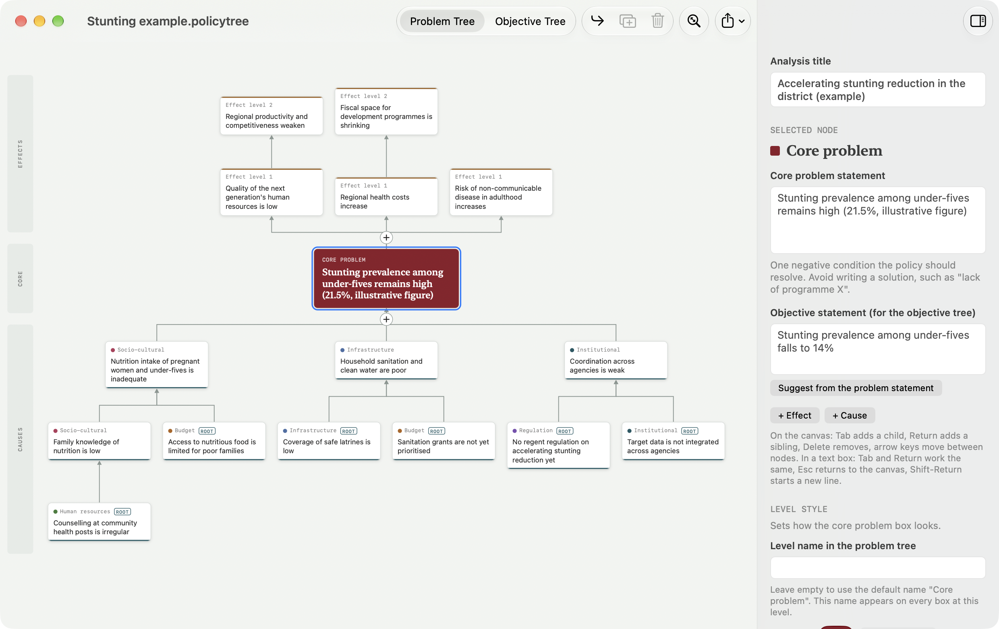
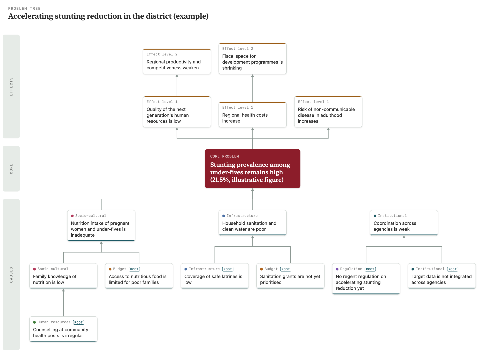
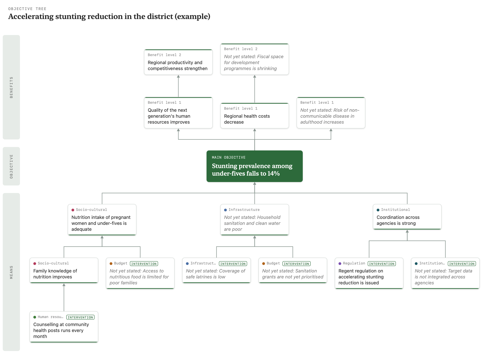
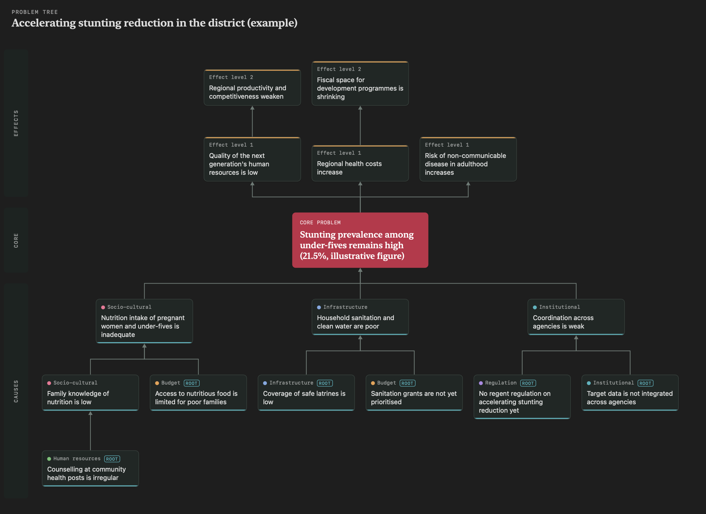

# Policy Tree

Alat penyusun pohon masalah kebijakan yang bisa diubah menjadi pohon tujuan. Versi 1.0.
Dibuat oleh [@lemonspitz](https://github.com/lemonspitz).

*A problem-tree and objective-tree builder for policy analysis, for Mac and Windows. The interface is
available in Indonesian and English (Settings → Language).*

## Tangkapan layar / Screenshots

**Aplikasi Mac / The Mac app:** kanvas pohon di kiri, inspektor untuk kotak terpilih di kanan.
*The tree canvas on the left, the inspector for the selected box on the right.*



**Pohon masalah / Problem tree:** akibat di atas, masalah inti di tengah, penyebab di bawah, dengan kategori dan
penanda akar masalah. *Effects on top, the core problem in the middle, causes below, with categories and root-cause tags.*



**Pohon tujuan / Objective tree:** dibuat dari pohon masalah; kotak yang belum dirumuskan ditandai.
*Turned from the problem tree; boxes not yet rewritten as objectives are marked.*



**Tema gelap / Dark theme**



*Contoh: percepatan penurunan stunting (angka ilustratif). Example: accelerating stunting reduction (illustrative figures).*

## Unduh / Download

Ambil versi terbaru di halaman [Releases](https://github.com/lemonspitz/PolicyTree/releases/latest):

- **Mac** (Apple Silicon, macOS 14+): `Policy-Tree-Mac.zip`. Buka zip, seret **Policy Tree.app** ke *Applications*.
  Aplikasi belum dinotarisasi Apple, jadi saat pertama dibuka: klik kanan → **Buka**, atau buka
  *Pengaturan Sistem → Privasi & Keamanan → Tetap Buka*.
- **Windows** (10/11, 64-bit): `Policy-Tree-Windows.zip`. Ekstrak, lalu jalankan `Install.cmd`
  (tanpa hak administrator). Jika muncul peringatan SmartScreen: **More info → Run anyway**.

## Pengembangan

- **macOS:** AppKit native, Apple Silicon, macOS 14+. Ikon Liquid Glass di `Resources/AppIcon.icon`.
- **Windows:** PySide6 di folder `windows/`, dibangun oleh GitHub Actions atau `windows\\build-windows.cmd`.

Berkas `.policytree` sama persis di kedua versi.

```bash
./build.sh    # menghasilkan "build/Policy Tree.app" (`--install` menyalin ke /Applications)
./test.sh     # tes model dan tata letak, lalu uji UI pada jendela sungguhan
```

Setiap pohon adalah dokumen `.policytree` (JSON; berkas `.pohon` lama tetap terbuka), jadi simpan otomatis, riwayat versi, jendela/tab, dan
Berkas Terkini mengikuti perilaku macOS. JSON yang disalin dari versi web bisa dibuka langsung.

**Gaya level.** Setiap level (masalah inti, dampak tingkat n, penyebab tingkat n) bisa diberi nama sendiri
(terpisah untuk pohon masalah dan pohon tujuan), warna, dan bentuk (persegi membulat, persegi, kapsul, segi enam,
elips) dari bagian *Gaya level* di panel kanan. Gaya disimpan di kunci `levels` dalam berkas, misalnya
`"cause.2": {"name": "Akar langsung", "color": "#1A7F5A", "shape": "hexagon"}`. Berkas tanpa gaya tidak memuat kunci ini,
dan nilai yang tidak dikenal diabaikan. **Pohon > Kembalikan Gaya Semua Level** menghapus semuanya.

**Pengaturan** (Mac: *Policy Tree > Pengaturan…*, ⌘,; Windows: *Berkas > Pengaturan…*, Ctrl+,): bahasa
(Bahasa Indonesia, English, atau ikuti sistem; berlaku setelah aplikasi dibuka ulang), tema (sistem, terang, gelap),
resolusi ekspor PNG (1×–3×), dan petunjuk keyboard di panel kanan.

**Bahasa.** Teks bahasa Indonesia di kode adalah kuncinya: `L("Tambah Penyebab")` di Swift dan Python.
Terjemahan bahasa Inggris ada di satu berkas untuk kedua aplikasi, `windows/policytree/strings_en.json`
(build Mac menyalinnya ke dalam app). `{0}`, `{1}` diisi setelah diterjemahkan, dan `kata|konteks` membedakan
dua terjemahan untuk satu kata Indonesia. `python3 tools/i18n_check.py` (juga dijalankan `test.sh` dan CI Windows)
gagal bila ada teks tanpa terjemahan atau terjemahan yang tak terpakai. Contoh stunting dan aturan "Usulkan
tujuan" punya versi bahasa Inggris sendiri di `Model.swift` dan `model.py`.

| Berkas | Isi |
| --- | --- |
| `Sources/Model.swift` | Data pohon, penyuntingan, analisis, usulan rumusan tujuan (tanpa AppKit) |
| `Sources/Layout.swift` | Geometri pohon (tanpa AppKit) |
| `Sources/Render.swift` | Warna, gambar pohon, ekspor PNG/PDF, ikon |
| `Sources/TreeView.swift` | Kanvas: mouse, keyboard, aksesibilitas |
| `Sources/Inspector.swift` | Panel kanan |
| `Sources/Document.swift` | Berkas, undo, cetak |
| `Sources/WindowController.swift` | Jendela, bilah alat, aksi menu |
| `Sources/main.swift` | Menu dan peluncuran |

### Windows

```bash
cd windows
python tests/test_model.py
python tests/smoke.py hasil-tangkapan
```

Jika ikon berubah, jalankan `windows/make-icon.sh` di Mac untuk membuat ulang `icon.png` dan `icon.ico`.
